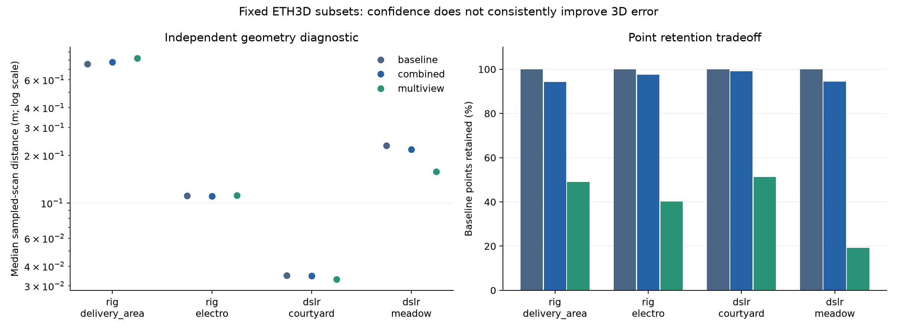

# Measured results

Generated from `benchmarks/measured/results.json`; all values below are measured.
See `manifest.json` for exact selected images, commands, versions and configurations.

The run completed 31 experiments: 27 two-view scenes and 4 multi-view subsets.
Completed means the pipeline and evaluation ran; it does not imply all selected cameras registered.

## Two-view estimated SfM

Baseline triangulation produced 12,980 points across the 27 scenes.
The combined filter had lower median sparse 3D error in 8/19 scenes with defined ground-truth errors for both methods.
It returned zero points in 5 scenes: delivery_area_1l, delivery_area_2s, facade_1s, playground_2s, terrace_1s.
Other undefined errors indicate that retained features had no eligible non-occluded ground-truth samples.
The multi-view support filter returns zero points for every two-view scene because its minimum support is three.

| Scene | Baseline points | Combined points | Baseline median error (m) | Combined median error (m) | Grid retention (%) |
|---|---:|---:|---:|---:|---:|
| delivery_area_1l | 165 | 0 | 6.5371 | undefined | 0.0 |
| delivery_area_1s | 491 | 188 | 2.8607 | 0.3316 | 61.4 |
| delivery_area_2l | 333 | 194 | 0.4225 | 0.1837 | 60.5 |
| delivery_area_2s | 157 | 0 | 12.0402 | undefined | 0.0 |
| delivery_area_3l | 213 | 7 | 1.7862 | 18.4761 | 4.4 |
| delivery_area_3s | 267 | 187 | 5.4286 | 5.3587 | 75.2 |
| electro_1l | 602 | 602 | 0.8567 | 0.8567 | 100.0 |
| electro_1s | 495 | 495 | 1.2737 | 1.2737 | 100.0 |
| electro_2l | 501 | 314 | 0.7400 | 0.7504 | 77.2 |
| electro_2s | 129 | 46 | 196.9864 | undefined | 30.6 |
| electro_3l | 122 | 15 | 0.6077 | 0.6582 | 26.5 |
| electro_3s | 74 | 28 | 3.0961 | 3.6495 | 46.4 |
| facade_1s | 566 | 0 | 17.3031 | undefined | 0.0 |
| forest_1s | 1673 | 1672 | 1.7222 | 1.7222 | 100.0 |
| forest_2s | 1095 | 1095 | 1.7322 | 1.7322 | 100.0 |
| playground_1l | 450 | 3 | 19.3655 | undefined | 4.2 |
| playground_1s | 471 | 27 | 4.4458 | undefined | 7.7 |
| playground_2l | 517 | 346 | 0.6578 | 0.5341 | 49.2 |
| playground_2s | 194 | 0 | 1.9462 | undefined | 0.0 |
| playground_3l | 1157 | 1021 | 0.0960 | 0.0925 | 95.0 |
| playground_3s | 1067 | 962 | 0.0897 | 0.0859 | 91.1 |
| terrace_1s | 346 | 0 | 17.7740 | undefined | 0.0 |
| terrace_2s | 477 | 181 | 1.8210 | 1.3778 | 45.0 |
| terrains_1l | 453 | 453 | 0.0512 | 0.0512 | 100.0 |
| terrains_1s | 702 | 702 | 0.1486 | 0.1486 | 100.0 |
| terrains_2l | 163 | 163 | 0.1026 | 0.1026 | 100.0 |
| terrains_2s | 100 | 1 | 3.5650 | 1.8359 | 2.9 |

Errors use nearest-pixel PFM disparity and calibrated baseline scale in the first-camera frame.
Very weak parallax can lead to incorrect estimated pose/depth despite small pixel residuals.

## Multi-view estimated SfM

Sources are low-resolution rig sequences and high-resolution DSLR datasets resized to 1600 px maximum.
Distances are nearest neighbors to fixed 200,000-point scene scan samples after camera-pose similarity alignment.
They are approximate diagnostics, not official ETH3D accuracy/completeness scores.

| Subset | Method | Cameras | Points | Retention (%) | Grid retention (%) | Median scan distance (m) | Median reprojection (px) |
|---|---|---:|---:|---:|---:|---:|---:|
| rig_delivery_area | baseline | 5/5 | 562 | 100.0 | 100.0 | 0.7557 | 0.2268 |
| rig_delivery_area | combined | 5/5 | 530 | 94.3 | 95.3 | 0.7756 | 0.2150 |
| rig_delivery_area | multiview | 5/5 | 275 | 48.9 | 75.9 | 0.8222 | 0.2580 |
| rig_electro | baseline | 5/5 | 276 | 100.0 | 100.0 | 0.1109 | 0.1714 |
| rig_electro | combined | 5/5 | 269 | 97.5 | 94.9 | 0.1108 | 0.1667 |
| rig_electro | multiview | 5/5 | 111 | 40.2 | 66.4 | 0.1117 | 0.2956 |
| dslr_courtyard | baseline | 6/6 | 5267 | 100.0 | 100.0 | 0.0348 | 0.0925 |
| dslr_courtyard | combined | 6/6 | 5219 | 99.1 | 99.0 | 0.0347 | 0.0917 |
| dslr_courtyard | multiview | 6/6 | 2704 | 51.3 | 83.3 | 0.0330 | 0.1245 |
| dslr_meadow | baseline | 5/6 | 359 | 100.0 | 100.0 | 0.2313 | 0.1410 |
| dslr_meadow | combined | 5/6 | 339 | 94.4 | 96.9 | 0.2184 | 0.1304 |
| dslr_meadow | multiview | 5/6 | 69 | 19.2 | 55.3 | 0.1578 | 0.1966 |

| Subset | Reconstruction seconds | Peak process memory (MiB) |
|---|---:|---:|
| rig_delivery_area | 1.53 | 216.7 |
| rig_electro | 1.26 | 212.9 |
| dslr_courtyard | 29.53 | 509.7 |
| dslr_meadow | 16.59 | 508.1 |

Reconstruction time and memory refer to one frozen baseline; all filters share that cost.
The complete CSV includes reprojection-only, angle-only, and both point-count-matched controls.

## Interpretation

Confidence filtering does not consistently improve the independent ground-truth diagnostics.
Observation-support filtering can lower scan distance on some DSLR subsets while discarding much of the cloud and image coverage.
The experiment does not establish a general accuracy advantage for the proposed heuristic.
Pose estimation errors cannot be repaired by discarding individual points from a frozen reconstruction.
These are prespecified exploratory training-data runs, with no held-out or multi-seed significance claim.

